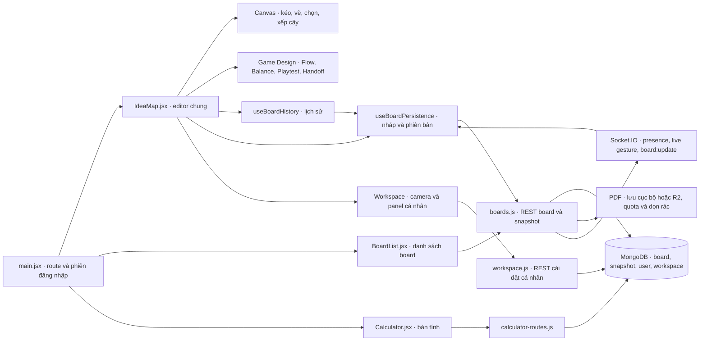

# Bản đồ hệ thống Board Tools

[Danh mục từng file](2026-11-27-system-file-inventory.md) · [Thiết kế refactor](superpowers/specs/2026-11-27-project-refactor-design.md) · [Kế hoạch](superpowers/plans/2026-11-27-project-refactor.md)

## Phạm vi

Ảnh chụp tại Git `cc60553b` cộng với thay đổi trong worktree trước khi lập báo cáo. Danh mục có 352 đường dẫn, gồm 337 file Git theo dõi và 15 file đang làm trong client, server và docs. Graphify phân tích cấu trúc 124 module JavaScript dùng lúc chạy hoặc kiểm thử tích hợp, thu được 1.251 nút và 3.448 cạnh. File test, bản dịch, cấu hình, tài nguyên và tài liệu được kiểm kê riêng. Danh mục ghi đường dẫn tài liệu và lịch sử trao đổi. Dữ liệu đăng nhập, file môi trường thật, log và đầu ra build nằm ngoài phạm vi.

## Luồng chạy

## Trách nhiệm theo nhóm file

| Khu vực | File đại diện | Ranh giới cần giữ |
|---|---|---|
| Khởi động, auth, danh sách | `client/src/main.jsx`, `context/AuthContext.jsx`, `components/LoginGate.jsx`, `pages/BoardList.jsx`, `server/index.js`, `auth.js` | Phiên đăng nhập, quyền và định tuyến. Kiểm quyền ở server cho REST và socket. |
| Mô hình và lưu board | `IdeaMap.jsx`, `useBoardPersistence.js`, `rebase.js`, `api.js`, `server/boards.js`, `board-write.js`, `board-payload.js`, `models.js` | Cùng một hợp đồng phiên bản cho chỉnh sửa thường, import và restore. Phân biệt nháp, bản server đã xác nhận và dữ liệu chỉ để hiển thị. |
| Canvas và công cụ | `useInk.js`, `useLaser.js`, `shape.js`, `selection-box.js`, `tree-layout.js`, `locked-tree.js`, `IdeaCard.jsx`, `EdgeLayer.jsx` | Tương tác con trỏ và hình học cục bộ. Chốt thao tác qua editor, giữ đường đi undo/redo và phiên bản. |
| Cộng tác và workspace | `board-realtime.js`, `follow.js`, `live-text.js`, `usePresence.js`, `useLiveSync.js`, `workspace.js`, `workspace-state.js` | Overlay realtime không phải nội dung đã lưu. Camera và panel cá nhân không đi vào thay đổi nội dung board. |
| Game Design | `game-design.js`, `GameDesignPanel.jsx`, các panel Flow, Balance, Playtest, Decisions, Impact, Handoff và Reports | Phần mở rộng của board với dữ liệu cũ có thể thiếu trường. Chia theo nghiệp vụ và kiểm cùng hợp đồng dữ liệu server. |
| File và vận hành | `pdf-storage.js`, `pdf-quota.js`, `notify.js`, `server/scripts/`, `render.yaml` | MongoDB giữ tham chiếu và metadata. Upload, xoá, quota và migration có vòng đời riêng. |
| Bàn tính | `Calculator.jsx`, `calculator.js`, `calculator-routes.js` | State theo tài khoản. Giữ tính tương thích với bản mẫu cũ và kiểm ghi đến trễ độc lập với board. |
| Kiểm thử, giao diện, tài liệu | `*.test.js`, `client/src/__smoke__/`, `smoke-run.mjs`, `locales/`, `styles/`, `docs/` | Các bộ test là đường chuẩn hành vi. Kiểm Chromium cho luồng UI, giữ tài liệu thiết kế và lịch sử. |

## Kết luận và thứ tự xử lý

Các nhận định dưới đây ghi theo thời điểm kiểm kê. Xem [tóm tắt triển khai](superpowers/summaries/2026-11-27-project-refactor-summary.md) để đối chiếu với cấu trúc sau refactor.

1. **P0 — Đối chiếu tất cả đường ghi board trước khi tách tiếp canvas.** `useBoardHistory.js` giữ snapshot toàn board, còn `useBoardPersistence.js` gửi cả nội dung với phiên bản gần nhất. Đây là đường có thể ghi lại dữ liệu cũ khi undo sau cập nhật từ peer. Viết ca hai client để kiểm, rồi chuyển undo/redo sang đảo thay đổi của thao tác cục bộ nếu test xác nhận. Ghi rõ import/restore có ý định thay toàn bộ và xử lý riêng với nháp đang chờ.
2. **P0 — Kiểm hợp đồng lưu, phân quyền và file bằng API thật.** `boards.js` có 14 route gồm dữ liệu, snapshot, chia sẻ và file. `board-write.js` có test mô phỏng cập nhật có điều kiện. Cần chạy hai lượt ghi đồng thời trên MongoDB cô lập và kiểm dữ liệu cũ, quyền owner/editor/viewer, kiểm phát socket sau khi lưu và đồng bộ tham chiếu PDF. Sau đó mới tách router theo nghiệp vụ.
3. **P1 — Tách canvas theo vòng đời tương tác.** `IdeaMap.jsx` hiện 5.432 dòng, có 78 import nội bộ. Tách theo phần có thể kiểm riêng như chọn/kéo/resize, xếp cây, điều hướng camera và chuyển công cụ. Giữ logic hình học đã có test trong các module hiện hành. Chạy smoke và Chromium sau từng phần.
4. **P1 — Làm rõ hợp đồng Game Design.** `game-design.js` được 15 module runtime hoặc smoke import. Chuẩn hóa và báo cáo đang nằm cùng module. Chia theo cấu trúc dữ liệu, phân tích dependency và xuất báo cáo khi có fixture dùng chung để đối chiếu `board-payload.js`. Dùng ca một mechanic qua đặc tả, playtest, quyết định và handoff làm kiểm tra xuyên suốt.
5. **P2 — Chốt vận hành và tích hợp.** Đưa lệnh test, build, smoke và kiểm hợp đồng vào luồng kiểm tra có thể chạy lại. Rà Render, cấu hình mẫu và script migration với dữ liệu cô lập trước khi chốt. Giữ các module có ranh giới rõ như hình học thuần, workspace và bàn tính khi kiểm tra cho thấy hợp đồng phù hợp.

## Điều kiện kết thúc

- Hai người sửa các trường độc lập giữ được cả hai chỉnh sửa. Tình huống sửa trùng, mất mạng, undo/redo sau cập nhật, import và restore khi đang có nháp đều có kịch bản kiểm.
- Phiên đăng nhập, owner/editor/viewer, snapshot cũ, tài liệu Game Design, PDF và luồng cộng tác vượt qua ma trận kiểm tra.
- Unit test, production build, smoke và các kiểm tra Chromium liên quan qua trên bản cuối trong worktree trước khi tích hợp.
